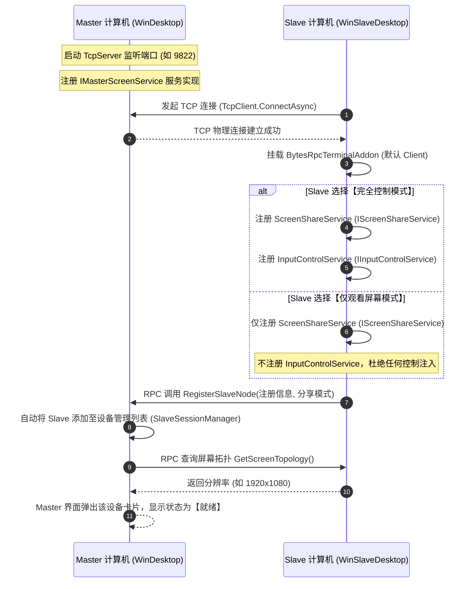
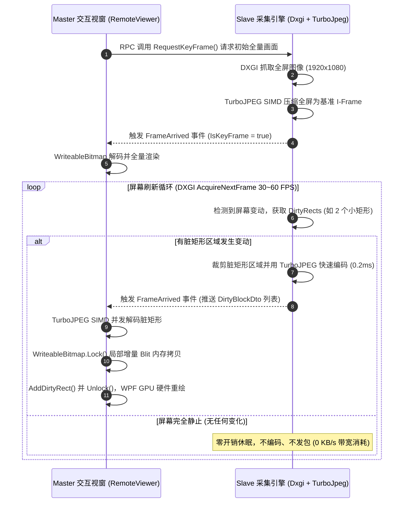
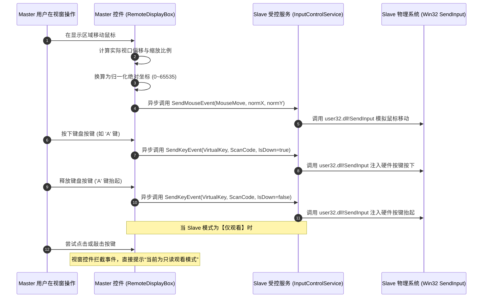
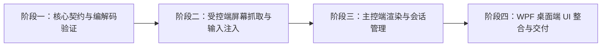

# ApeFree.DonateScreen 项目技术可行性分析报告

**项目名称**：ApeFree.DonateScreen（主动捐赠式远程屏幕分享与控制系统）  
**文档版本**：v1.0.0  
**报告日期**：2026-10-13  
**目标目录**：`C:\Users\Administrator\Documents\ApeFree\ApeFree.DonateScreen`  
**参考工程**：`C:\Users\Administrator\Documents\ApeFree\ApeFree.DonateDisk`  
**核心技术栈**：.NET 8+ / .NET 10、WPF (Windows Presentation Foundation)、ScreenCapture.NET (DXGI Desktop Duplication API)、TurboJPEG (SIMD 加速)、ApeFree.ApeRpc.BytesIO、STTech.BytesIO、Win32 SendInput API  

---

## 一、 项目背景与需求概述

### 1.1 项目愿景与架构对标
`ApeFree.DonateScreen` 是一个面向 Windows 平台的**主动捐赠式远程屏幕分享与远程键盘鼠标控制系统**。
其核心架构完全继承自 `ApeFree.DonateDisk` 的“主动献出（Donate）与对等直连”哲学。

传统远程桌面软件（如 Windows 自带的 RDP、VNC、TeamViewer、AnyDesk 等）通常存在以下痛点：
1. **被动监听与内网穿透困难**：受控机通常需要开放本地端口监听，在复杂的 NAT、移动宽带、企业防火墙等内网环境下，主控机难以直连受控机；
2. **中心化服务器强依赖**：大部分商业远程桌面均重度依赖厂商云端信令与中继服务器，存在数据隐私泄露隐患与网络带宽限速问题；
3. **功能耦合与权限粗放**：受控端通常无法将“屏幕观看”与“键鼠控制”细粒度解耦，受控用户缺乏清晰的安全掌控力。

本项目的核心设计理念为**“Slave 主动献出（Donate）本地屏幕与控制权，Master 接收画面并实施交互控制”**：
- **架构完全对标 `ApeFree.DonateDisk`**：
  - 在 `ApeFree.DonateDisk` 中：Slave 端将本地文件系统操作契约共享给 Master，Master 通过 Dokany 挂载为本地虚拟磁盘。
  - 在 `ApeFree.DonateScreen` 中：Slave 端将本地屏幕画面与键盘鼠标输入契约共享给 Master，Master 通过 WPF 桌面窗口渲染远端实时画面，并将本地键盘鼠标操作无感映射至 Slave 端。
  - **网络拓扑完全一致**：网络链路均由位于内网的 Slave 端主动发起 TCP 连接至 Master 端，突破反向连接与穿透壁垒。

### 1.2 规划的工程子集与职责划分
本项目规划由三个核心子工程组成：

1. **`ApeFree.DonateScreen` (核心类库 Core Library)**：
   - 目标框架：`net8.0-windows` / `net10.0-windows`。
   - 职责：
     - 定义跨端远程通信服务契约接口（`IScreenShareService`、`IInputControlService`、`IMasterScreenService`）；
     - 定义高性能传输 DTO（脏矩形帧数据包、屏幕分辨率元数据、鼠标/键盘输入动作数据包）；
     - 封装 Slave 端屏幕捕获管道（DXGI 抓屏、脏矩形差量提取、TurboJPEG SIMD 压缩编码）；
     - 封装 Slave 端输入控制执行引擎（Win32 `SendInput` 坐标换算与按键注入）；
     - 封装 Master 端流式帧重组、TurboJPEG SIMD 解码、多 Slave 会话管理器（`SlaveSessionManager`）。
2. **`ApeFree.DonateScreen.WinSlaveDesktop` (受控端桌面程序 WPF Desktop)**：
   - 目标框架：`net8.0-windows` / `net10.0-windows`。
   - 职责：
     - 面向仅需将自身作为受控端分享出去的用户；
     - 提供目标 Master IP 与端口配置、网络连接状态可视化仪表盘；
     - **分享模式切换**：支持“完全控制”（同时提供屏幕与键鼠）与“仅观看屏幕”（仅提供屏幕只读权限）两种模式；
     - 屏幕参数调节（多显示器选择、帧率上限 30/60 FPS、JPEG 压缩质量滑块、强制关键帧刷新）；
     - 紧急切断防护（受控端本地一键终止受控、按键拦截安全退出）。
3. **`ApeFree.DonateScreen.WinDesktop` (综合主控/受控桌面程序 WPF Desktop)**：
   - 目标框架：`net8.0-windows` / `net10.0-windows`。
   - 依赖关系：直接引用 `ApeFree.DonateScreen.WinSlaveDesktop`。
   - 职责：
     - **作为受控端（被控功能）**：继承并无缝复用 `WinSlaveDesktop` 的所有受控功能，本台电脑也能随时作为 Slave 分享出去；
     - **作为主控端（Master 功能）**：
       - 本地启动 TCP 监听服务器（基于 `STTech.BytesIO.Tcp.TcpServer`）；
       - **多 Slave 设备接入列表**：实时展示所有接入的 Slave 客户端卡片/表格（设备名称、IP 归属、分辨率、分享模式标签、网络延迟、在线时长等）；
       - **远程交互控制视窗**：多窗口/多标签页打开远程桌面会话，利用 WPF `WriteableBitmap` 超低延迟呈现画面，实时捕获鼠标与键盘事件并透明转发给目标 Slave。

---

## 二、 关键技术选型可行性评估

### 2.1 整体架构拓扑与交互全景图

```
┌────────────────────────────────────────────────────────────────────────┐
│              Master 计算机 (WinDesktop - 主控端 / 监听端)               │
│  ┌─────────────────────────────────┐   ┌────────────────────────────┐  │
│  │ WPF Remote Desktop Viewer 视窗  │   │  Slave 设备接入管理列表    │  │
│  │ (WriteableBitmap 局部增量渲染)  │   │  (SlaveSessionManager)     │  │
│  └────────────────┬────────────────┘   └─────────────┬──────────────┘  │
│     显示画面      │ 捕获用户鼠标/键盘输入             │ 维护接入连接   │
│  ┌────────────────▼────────────────┐   ┌─────────────▼──────────────┐  │
│  │ TurboJPEG SIMD 解码器           │   │ MasterScreenService        │  │
│  │ (TurboJpegDecoder)              │   │ (IMasterScreenService 实现)│  │
│  └────────────────┬────────────────┘   └─────────────┬──────────────┘  │
│                   │ 还原 RGB 脏矩形                  │ 接收就绪事件   │
│  ┌────────────────▼──────────────────────────────────▼──────────────┐  │
│  │               ApeFree.ApeRpc.BytesIO (Master 节点)               │  │
│  │                [STTech.BytesIO.Tcp.TcpServer 监听]                │  │
│  └─────────────────────────────────▲────────────────────────────────┘  │
└────────────────────────────────────┼───────────────────────────────────┘
                       TCP 直连信道 (全双工通信)
                       ApeRpc Request/Reply/Event 二进制帧 (Jbin)
┌────────────────────────────────────┼───────────────────────────────────┐
│  ┌─────────────────────────────────▼────────────────────────────────┐  │
│  │               ApeFree.ApeRpc.BytesIO (Slave 节点)                │  │
│  │                [STTech.BytesIO.Tcp.TcpClient 连接]               │  │
│  └────────────────┬──────────────────────────────────┬──────────────┘  │
│                   │ 动态暴露服务代理                 │ 动态暴露服务代理│
│  ┌────────────────▼────────────────┐   ┌─────────────▼──────────────┐  │
│  │ IScreenShareService 实现        │   │ IInputControlService 实现  │  │
│  │ (ScreenShareService - 屏幕服务) │   │ (InputControlService 键鼠) │  │
│  │ [只读模式与完全控制模式均注册]  │   │ [仅“完全控制”模式下暴露]   │  │
│  └────────────────┬────────────────┘   └─────────────┬──────────────┘  │
│                   │ 脏矩形压缩包推流                 │ 注入 Win32 输入 │
│  ┌────────────────▼────────────────┐   ┌─────────────▼──────────────┐  │
│  │ ScreenCapture.NET (DXGI DDA)    │   │ Win32 SendInput 模拟执行器 │  │
│  │ + TurboJPEG SIMD 压缩编码器     │   │ (鼠标坐标映射/键盘扫描码)  │  │
│  └────────────────▲────────────────┘   └─────────────┬──────────────┘  │
│                   │ GPU 显存帧指针                   │ 驱动级输入事件  │
│  ┌────────────────┴──────────────────────────────────▼──────────────┐  │
│  │          Slave 物理系统 (显卡显存 / OS 桌面 / 物理输入消息队)    │  │
│  └──────────────────────────────────────────────────────────────────┘  │
│               Slave 计算机 (WinSlaveDesktop - 受控端 / 发起端)         │
└────────────────────────────────────────────────────────────────────────┘
```

### 2.2 屏幕截取方案：ScreenCapture.NET (DXGI Desktop Duplication API)
- **技术现状与工作机理**：
  - Windows 原生 GDI 截屏（如 `BitBlt`）性能低下，CPU 占用高达 20%~40%，且在 1080P/2K 分辨率下很难稳定达到 30 FPS；
  - `ScreenCapture.NET` 基于微软官方 **DXGI Desktop Duplication API (DDA)**，直接与 Direct3D 11 / DXGI 管道通信。
  - DDA 由显卡驱动直接提供每帧显存表面的直接访问指针（GPU Texture2D）。抓取一帧画面耗时通常在 **0.5ms ~ 2ms** 之间，CPU 占用率低于 2%，可轻松达到 60 FPS 甚至 120 FPS 的电竞级帧率。
- **可行性分析**：
  1. **零内存拷贝 (Zero-Copy 潜力)**：显存帧通过 Staging 纹理映射到 CPU 虚拟地址空间，获取直接内存指针 `IntPtr pScan0`，跳过任何冗余的中介内存拷贝；
  2. **原生脏矩形（Dirty Rects）与移动矩形（Move Rects）**：
     - DXGI `AcquireNextFrame` 调用时，DXGI 驱动原生返回当前帧相对于上一帧所变化的矩形区域集合（`DXGI_OUTDUPL_FRAME_INFO.DirtyRects`）；
     - 这一特性是低延迟屏幕传输的核心基础：在桌面静态或只有部分窗口（如光标移动、打字、代码编辑）变动时，无需对全屏进行抓取和压缩，处理开销降低 90% 以上。

### 2.3 差量分块与图像压缩方案：Dirty Rects + TurboJPEG (SIMD)
- **为什么不采用 H.264 / H.265 视频流？**
  - 视频编解码器（如 NVENC、MediaFoundation、FFmpeg）是面向连续全屏运动画面（如电影、3D 游戏）设计的；
  - 视频编解码存在帧间运动估计（GOP）、B 帧双向缓冲、码率平滑缓冲等机制，带来固有端到端延迟（通常在 60ms ~ 150ms）；
  - 桌面操作具有典型的“大面积静态、局部高频爆发变动”特性。H.264 面对高频文字边缘易出现模糊伪影；
  - 显卡硬件编码器（NVENC）在消费级显卡上存在最大并发会话数限制（通常为 3~5 路），不利于 Master 端同时挂载多台 Slave。
- **TurboJPEG (LibJpeg-Turbo) + 脏矩形裁剪的极致优势**：
  1. **SIMD 硬件加速**：TurboJPEG 深度利用 x86/x64 的 SSE2/AVX2 以及 ARM 的 NEON 汇编指令集，其 JPEG 编解码速度是普通 `System.Drawing` 或标准 `libjpeg` 的 3 到 6 倍；
  2. **极短耗时**：
     - 局部脏矩形（如 200x200 像素文本区域）压缩耗时 **< 0.3ms**；
     - 1080P 全屏全量帧压缩耗时 **仅需 4~8ms**；
  3. **独立块无状态性（Stateless Chunks）**：
     - 每一个脏矩形块都是独立的 JPEG 字节流，解压时直接覆盖回对应坐标，不存在任何前置帧参考依赖；若网络中个别脏矩形包延迟，后续脏矩形可直接覆盖，绝不会出现 H.264 丢包花屏且必须等待下一个 I 帧的现象。

### 2.4 远程调用与通信方案：ApeFree.ApeRpc.BytesIO
- **技术现状与设计匹配度**：
  - `ApeFree.ApeRpc.BytesIO` 是基于 `STTech.BytesIO` 的直连式点对点高性能轻量级 RPC 类库；
  - 支持 `TcpServer` 与 `TcpClient`，具备全双工对称通信能力；
  - 数据格式采用 `RpcDataFormat.Jbin`，相比 JSON 具有极高的序列化与反序列化效率，并原生支持 `byte[]` 裸二进制的高性能承载；
  - 单包协议上限达到 64MB（`BytesRpcProtocol.MaxPacketLength`），内置 `BytesRpcUnpacker` 自动处理 TCP 粘包与分包。
- **全双工反向代理可行性分析（核心架构契合点）**：
  - 在常规远程控制软件中，控制端为 Client，受控端为 Server。这要求受控端必须拥有公网 IP 或配置端口映射；
  - 在 `ApeFree.DonateScreen` 中，**Slave 端主动发起 `TcpClient.ConnectAsync()` 连入 Master 端的 `TcpServer`**；
  - 根据 `ApeRpc.BytesIO` 的通道对称性，在物理 TCP 连接建立后，通信双方地位完全对等：
    - Slave 在本地 `RpcTerminal` 注册 `ScreenShareService` 和（可选的）`InputControlService`；
    - Master 端监听到客户端连接后，可通过 `masterAddon.QueryService<IScreenShareService>(nameof(ScreenShareService), slaveClient)` 获取动态代理对象；
    - Slave 端通过 `[RpcEvent(IsForcedSubscription = true)]` 主动向 Master 推送脏矩形帧事件；
    - Master 端通过调用 `IInputControlService` 代理接口方法，将键盘鼠标指令秒级反向调用至 Slave 端执行。

### 2.5 键盘鼠标输入控制方案：Win32 SendInput API
- **技术现状**：Windows 平台最底层、权威且低延迟的合成用户输入 API 是 `user32.dll!SendInput`。
- **可行性分析**：
  1. **绝对坐标与相对坐标精确映射**：
     - Windows `SendInput` 的绝对鼠标移动要求坐标范围归一化至 `[0, 65535]`：
       $$\text{normalizedX} = \frac{\text{targetX} \times 65535}{\text{displayWidth} - 1}$$
       $$\text{normalizedY} = \frac{\text{targetY} \times 65535}{\text{displayHeight} - 1}$$
     - 结合 `MOUSEEVENTF_ABSOLUTE | MOUSEEVENTF_MOVE`，能够克服两端分辨率不一致与高 DPI 缩放问题；
  2. **硬件扫描码（Scan Code）支持**：
     - 键盘输入同时携带虚拟键码（Virtual-Key）与硬件扫描码（Scan Code），确保不仅普通字符输入正常，快捷键（Win 键、Ctrl/Alt 组合键）及 DirectX/游戏类应用也能准确识别；
  3. **受控端分享权限细粒度隔离**：
     - 当 Slave 选择“仅观看屏幕”模式时，Slave 端根本不注册 `IInputControlService` 服务，或者在该服务内部直接短路抛出未授权异常，从而在 RPC 契约层面形成物理级安全屏障。

---

## 三、 系统架构与服务契约设计

### 3.1 核心服务契约设计 (Contracts)

依据需求，**屏幕画面传输和键盘鼠标控制严格分为两个独立的接口**。Slave 端可根据用户选择的分享模式，决定是否开放输入控制接口。

#### 3.1.1 屏幕共享契约：`IScreenShareService`
由 Slave 端实现并暴露，Master 端通过代理调用或订阅事件。

```csharp
namespace ApeFree.DonateScreen.Contracts
{
    /// <summary>
    /// 远程屏幕共享服务契约。
    /// 由 Slave 端实现并暴露，Master 端通过代理获取屏幕元数据并接收实时脏矩形帧流。
    /// </summary>
    public interface IScreenShareService
    {
        /// <summary>
        /// 屏幕增量脏矩形帧主动推送事件。
        /// 标记为强制自动订阅，连接建立后 Slave 端采集循环主动向 Master 推送增量帧。
        /// </summary>
        [RpcEvent(IsForcedSubscription = true)]
        event EventHandler<ScreenFramePacketDto> FrameArrived;

        /// <summary>
        /// 屏幕拓扑与分辨率变动事件（如受控端分辨率切换、多显示器插拔）
        /// </summary>
        [RpcEvent(IsForcedSubscription = true)]
        event EventHandler<ScreenTopologyDto> TopologyChanged;

        /// <summary>
        /// 获取受控端当前显示器拓扑与分辨率信息
        /// </summary>
        [InvariableProperty]
        ScreenTopologyDto GetScreenTopology();

        /// <summary>
        /// 主动请求受控端立即生成并发送一个全屏完整关键帧（I-Frame/Full Refresh）
        /// 通常用于 Master 端刚刚接入、画面异常或用户手动点击“强制刷新”时调用。
        /// </summary>
        void RequestKeyFrame();

        /// <summary>
        /// 动态调整屏幕采集与编码参数
        /// </summary>
        /// <param name="options">编码与捕获配置（如最大 FPS、JPEG 质量 1~100、选中显示器索引）</param>
        void UpdateCaptureOptions(CaptureOptionsDto options);

        /// <summary>
        /// 暂停或恢复屏幕帧的主动推送
        /// </summary>
        /// <param name="isPaused">是否暂停推流</param>
        void SetStreamingPaused(bool isPaused);
    }
}
```

#### 3.1.2 键盘鼠标输入控制契约：`IInputControlService`
由 Slave 端实现并按需暴露。在“仅观看屏幕”模式下，Slave 不注册此服务；在“完全控制”模式下，Slave 注册此服务。

```csharp
namespace ApeFree.DonateScreen.Contracts
{
    /// <summary>
    /// 远程键盘鼠标输入控制服务契约。
    /// 由 Slave 端根据分享模式选择性暴露；Master 端通过代理将用户在显示视窗上的操作注入受控机。
    /// </summary>
    public interface IInputControlService
    {
        /// <summary>
        /// 发送鼠标绝对位置移动与滚动事件
        /// </summary>
        /// <param name="dto">鼠标动作数据包（归一化坐标、滚轮增量、按键动作）</param>
        void SendMouseEvent(MouseEventDto dto);

        /// <summary>
        /// 发送键盘按键事件（按下/释放）
        /// </summary>
        /// <param name="dto">键盘动作数据包（虚拟键码、硬件扫描码、扩展键标志、按键状态）</param>
        void SendKeyEvent(KeyEventDto dto);

        /// <summary>
        /// 批量发送按键动作（如发送字符串文本或模拟快捷键宏）
        /// </summary>
        /// <param name="events">按键序列</param>
        void SendKeySequence(List<KeyEventDto> events);

        /// <summary>
        /// 紧急复位受控机所有按键状态（释放所有被按下的 Ctrl/Shift/Alt/Win 等按键，防止键位粘滞）
        /// </summary>
        void ResetInputState();
    }
}
```

#### 3.1.3 Master 协同控制契约：`IMasterScreenService`
由 Master 端实现并暴露，Slave 端在 TCP 建立后可主动调用，用于向 Master 登记上线并传递设备元数据。

```csharp
namespace ApeFree.DonateScreen.Contracts
{
    /// <summary>
    /// Master 节点协同与受控端注册服务契约。
    /// 由 Master 端实现并暴露，Slave 端在接入后主动通知 Master 节点登记受控设备信息。
    /// </summary>
    public interface IMasterScreenService
    {
        /// <summary>
        /// Slave 节点向 Master 注册自身设备信息与共享模式
        /// </summary>
        /// <param name="info">Slave 设备基本信息（机器名、操作系统、分享模式、屏幕分辨率等）</param>
        void RegisterSlaveNode(SlaveNodeRegistrationDto info);

        /// <summary>
        /// 心跳保活与状态汇报
        /// </summary>
        void Heartbeat(string slaveId, long timestamp);
    }
}
```

### 3.2 关键 DTO 数据模型设计

```csharp
namespace ApeFree.DonateScreen.Contracts
{
    /// <summary>
    /// 共享模式枚举
    /// </summary>
    public enum ScreenShareMode
    {
        /// <summary>
        /// 仅观看屏幕（只读，不暴露 IInputControlService）
        /// </summary>
        ViewOnly = 0,

        /// <summary>
        /// 完全控制（同时暴露屏幕与键盘鼠标输入）
        /// </summary>
        FullControl = 1
    }

    /// <summary>
    /// 单个脏矩形增量块
    /// </summary>
    public class DirtyBlockDto
    {
        public int X { get; set; }
        public int Y { get; set; }
        public int Width { get; set; }
        public int Height { get; set; }

        /// <summary>
        /// 经 TurboJPEG 压缩后的独立 JPEG 字节数组
        /// </summary>
        public byte[] CompressedData { get; set; }
    }

    /// <summary>
    /// 屏幕帧数据包（推送至 Master）
    /// </summary>
    public class ScreenFramePacketDto
    {
        public long FrameIndex { get; set; }
        public long Timestamp { get; set; }
        public int DisplayWidth { get; set; }
        public int DisplayHeight { get; set; }

        /// <summary>
        /// 是否为全屏全量关键帧
        /// </summary>
        public bool IsKeyFrame { get; set; }

        /// <summary>
        /// 变动的脏矩形块集合
        /// </summary>
        public List<DirtyBlockDto> Blocks { get; set; } = new();
    }

    /// <summary>
    /// 鼠标动作 DTO
    /// </summary>
    public class MouseEventDto
    {
        /// <summary>
        /// 绝对坐标 X (0 ~ 65535 归一化)
        /// </summary>
        public ushort NormalizedX { get; set; }

        /// <summary>
        /// 绝对坐标 Y (0 ~ 65535 归一化)
        /// </summary>
        public ushort NormalizedY { get; set; }

        /// <summary>
        /// 动作标志位 (Move, LeftDown, LeftUp, RightDown, RightUp, MiddleDown, MiddleUp, Wheel)
        /// </summary>
        public MouseActionFlags Flags { get; set; }

        /// <summary>
        /// 滚轮滚动增量 (通常每次滚动 120 的倍数)
        /// </summary>
        public int WheelDelta { get; set; }
    }

    /// <summary>
    /// 键盘动作 DTO
    /// </summary>
    public class KeyEventDto
    {
        public ushort VirtualKey { get; set; }
        public ushort ScanCode { get; set; }
        public bool IsKeyDown { get; set; }
        public bool IsExtendedKey { get; set; }
    }

    /// <summary>
    /// Slave 注册上线 DTO
    /// </summary>
    public class SlaveNodeRegistrationDto
    {
        public string SlaveId { get; set; }
        public string MachineName { get; set; }
        public string OsVersion { get; set; }
        public ScreenShareMode ShareMode { get; set; }
        public int DisplayWidth { get; set; }
        public int DisplayHeight { get; set; }
        public string Note { get; set; }
    }
}
```

---

## 四、 核心技术难点与可行性应对策略

### 4.1 难点一：高频屏幕捕获与海量图像压缩带来的 CPU/网络冲击
- **问题分析**：
  - 1080P 未压缩原始图像（BGRA 格式）单帧为 $1920 \times 1080 \times 4 \approx 7.91\text{ MB}$。在 60 FPS 下，每秒原始数据量达 **474 MB/s (3.79 Gbps)**，不仅千兆局域网无法承载，即便万兆局域网也会引发严重的内存拷贝拥塞；
  - 频繁执行大面积 JPEG 压缩如果处理不当，会导致受控端 CPU 瞬间飙升至 100%，拖慢系统正常应用。
- **应对方案**：
  1. **DXGI 脏矩形差量过滤（Delta Pruning）**：
     - 在普通办公、敲代码、浏览网页时，屏幕变动区域往往不足全屏的 5%（仅光标闪烁、几行文字变化或小区域弹窗）；
     - 利用 DXGI 原生返回的 `DirtyRects`，只提取变动的矩形子区域，忽略完全不变的静态像素。静态画面时每秒带宽为 **0 KB/s**；
  2. **脏矩形合并（Rect Consolidation / Bounding Box）**：
     - DXGI 有时会返回数十个细碎分散的极小矩形（如每个字符一个小矩形），分别单独压缩会导致大量小图像头开销；
     - 引入空间合并算法：当两个脏矩形距离过近时，自动聚合成一个外接大矩形，控制单帧内的分块数量通常在 1~8 个以内；
  3. **TurboJPEG SIMD 极速编码**：
     - 借助 TurboJPEG 的 C++ 原生动态库及 AVX2/SSE2 汇编指令集，局部 200x200 像素压缩仅需 0.1ms；
     - 提供动态画质自适应（Dynamic Quality Adaptation）：当网络 RTT 升高或出现丢帧时，自动将 JPEG Quality 从 85 平滑降至 60，保证操作的低延迟响应优先。

### 4.2 难点二：双向全双工 RPC 的流式推送背压与丢帧机制
- **问题分析**：
  - `ApeRpc.BytesIO` 的底层是 TCP 全双工通道。在网络抖动、带宽受限或 Master 端渲染负载较高时，如果 Slave 端依然盲目按照 60 FPS 持续产生数据帧并堆入发送队列，会导致 TCP 发送缓冲区不断膨胀，造成严重的“操作延迟越积越大（排队延迟）”现象；
  - 用户移动鼠标本应即时看到反应，由于中间积压了 20 帧旧画面，可能导致画面延迟高达 2~3 秒。
- **应对方案**：
  1. **低延迟优先与主动丢帧策略（Drop Frame on Queue Full）**：
     - 在 Slave 端建立一个容量极小的有界环形发送缓冲区（如大小为 1 或 2）；
     - 如果前一帧数据包尚未通过 TCP 完全发送出去，捕获线程新产生的中间帧直接丢弃，但在内部累加脏矩形范围；
     - 下一次发送时，发送的是“累积合并后的最新脏矩形”，这样既保证了画面最终一致性，又杜绝了帧排队延迟；
  2. **滑动窗口心跳应答与流控（Flow Control）**：
     - 屏幕数据包带有 `FrameIndex` 和 `Timestamp`；Master 端在渲染完成后可选择性回传简短 ACK 或当前 RTT。Slave 端依据 RTT 动态调整捕获帧率（例如在 30~60 FPS 之间自适应浮动）。

### 4.3 难点三：WPF 客户端超低延迟渲染与零 GC 内存优化
- **问题分析**：
  - WPF 传统的图像更新如果采用频繁 `new BitmapImage()` 或创建新的 `BitmapSource` 赋予 `Image.Source`，每秒 30~60 次创建大对象会导致 .NET 的 LOH（大对象堆）急剧膨胀，频繁触发 Full GC，造成主界面严重掉帧、卡顿甚至 OOM。
- **应对方案**：
  1. **常驻 `WriteableBitmap` 内存锁定写入**：
     - Master 端根据 Slave 分辨率在初始化时仅分配一次 `WriteableBitmap`（如 `Bgra32` 格式），赋给 WPF `Image` 控件；
     - 收到 Slave 推送的 `ScreenFramePacketDto` 后，TurboJPEG 解码器直接解压至临时复用缓冲区（或直接解压至目标内存指针）；
     - 调用 `WriteableBitmap.Lock()`，通过内存拷贝（`CopyMemory`）将脏矩形块直接写入 `BackBuffer` 的对应 `(X, Y)` 偏移位置；
     - 针对每个写入的块调用 `WriteableBitmap.AddDirtyRect(new Int32Rect(X, Y, Width, Height))`，最后调用 `WriteableBitmap.Unlock()`；
  2. **DirectX 硬件合成**：
     - WPF 底层渲染管线会自动仅对 `AddDirtyRect` 标记的区域进行 GPU 显存更新与硬件合成，达到真正的“零 GC 压力、微秒级更新、60 FPS 丝滑顺畅”。

### 4.4 难点四：多分辨率、高 DPI 与多显示器环境下的键鼠坐标精确映射
- **问题分析**：
  - Master 端的显示窗口可以任意拖动、缩放（最大化、窗口化、保持纵横比等）；
  - Master 屏幕可能有 125% 或 150% 的 Windows DPI 缩放，而 Slave 屏幕可能是 100% 或 200% DPI；两端物理分辨率也可能不同（如 Master 是 2560x1440，Slave 是 1920x1080）；
  - 若直接使用像素坐标，会导致鼠标点击位置产生严重偏差。
- **应对方案**：
  1. **视窗视口（Viewport）反向坐标计算**：
     - 在 WPF 的 `Image` 控件上捕获鼠标相对坐标 $(x_{\text{mouse}}, y_{\text{mouse}})$；
     - 根据 `Image.ActualWidth`、`Image.ActualHeight` 以及 `Stretch.Uniform` 计算出实际画面在控件内部的渲染视口偏移量 $(ox, oy)$ 与实际渲染宽高 $(w_{\text{render}}, h_{\text{render}})$；
     - 过滤掉黑边区域外的点击，计算出在原画面分辨率中的实际像素位置 $(px, py)$；
  2. **Windows 标准绝对归一化坐标转换**：
     - 将像素位置换算为 Windows `SendInput` 标准的 0~65535 绝对坐标：
       $$\text{normX} = \text{Clamp}\left(\frac{px \times 65535}{\text{DisplayWidth} - 1}, 0, 65535\right)$$
       $$\text{normY} = \text{Clamp}\left(\frac{py \times 65535}{\text{DisplayHeight} - 1}, 0, 65535\right)$$
     - 这一换算彻底屏蔽了两端系统的 DPI 缩放差异与物理显示器尺寸差异，保证像素级精准点击。

### 4.5 难点五：权限隔离与安全防护（受控端绝对掌控权）
- **问题分析**：
  - 远程控制系统具有极高的安全敏感性。必须防止主控端越权操作、恶意注入按键，以及网络异常时受控端出现按键死锁或画面无法收回的情况。
- **应对方案**：
  1. **契约级物理隔离（仅观看模式）**：
     - 当 Slave 用户在 UI 上选择“仅观看屏幕”时，Slave 端进程仅注册 `IScreenShareService`，**完全不注册 `IInputControlService`**；
     - Master 端即使尝试强行发起调用，RPC 底层会直接返回服务未注册错误，无法注入任何按键事件；
  2. **受控端最高物理控制权（Physical Override）**：
     - 受控端监听本地物理鼠标与键盘活动（或全局紧急热键如 `Ctrl + Alt + Break`）；
     - 当受控端物理移动鼠标或按键时，可自动暂时挂起远端输入的注入（或直接断开连接）；
  3. **连接异常与失联自动复位**：
     - 在 Slave 端监听 `TcpClient.OnDisconnected` 事件，当检测到与 Master 断开连接时，自动调用 `ResetInputState()` 释放所有可能处于按下状态的虚拟按键（如 Ctrl/Shift/Alt/Win），防止受控电脑按键卡死；同时停止 DXGI 屏幕抓取循环，彻底释放 GPU 显存资源。

---

## 五、 工程结构与模块职责划分

### 5.1 解决方案拓扑与工程依赖关系

```
ApeFree.DonateScreen/
├── ApeFree.DonateScreen.slnx                    # 解决方案文件 (.slnx / .sln)
├── build-release.ps1                            # 一键打包与发布脚本
├── FEASIBILITY_REPORT.md                        # 本可行性分析报告
│
├── src/
│   ├── ApeFree.DonateScreen/                    # 【核心类库】(net8.0-windows / net10.0-windows)
│   │   ├── Contracts/                           # 核心服务契约与 DTO
│   │   │   ├── IScreenShareService.cs           # 屏幕共享服务契约
│   │   │   ├── IInputControlService.cs          # 键盘鼠标控制服务契约
│   │   │   ├── IMasterScreenService.cs          # Master 协同注册服务契约
│   │   │   └── ScreenDtos.cs                    # 脏矩形帧、输入动作、注册信息等 DTO
│   │   │
│   │   ├── Slave/                               # 受控端核心逻辑
│   │   │   ├── ScreenSlaveNode.cs               # Slave 终端生命周期与网络连接管理
│   │   │   ├── ScreenShareService.cs            # IScreenShareService 实现 (捕获、编码与推流)
│   │   │   ├── InputControlService.cs           # IInputControlService 实现 (SendInput 模拟)
│   │   │   ├── Capture/                         # 屏幕捕获子系统
│   │   │   │   ├── DxgiScreenCapturer.cs        # ScreenCapture.NET (DXGI) 封装与脏矩形提取
│   │   │   │   └── DirtyRectOptimizer.cs        # 脏矩形合并与边界优化算法
│   │   │   └── Input/                           # 输入模拟子系统
│   │   │       ├── Win32InputSimulator.cs       # Win32 SendInput P/Invoke 封装
│   │   │       └── KeyCodeMapper.cs             # 键盘扫描码与虚拟键转换器
│   │   │
│   │   ├── Master/                              # 主控端核心逻辑
│   │   │   ├── ScreenMasterNode.cs              # Master 服务端监听与网络会话管理
│   │   │   ├── MasterScreenService.cs           # IMasterScreenService 实现
│   │   │   ├── SlaveSession.cs                  # 单个接入 Slave 会话封装 (包含代理与状态)
│   │   │   ├── SlaveSessionManager.cs           # 多 Slave 设备列表与生命周期调度
│   │   │   └── Rendering/                       # 渲染子系统
│   │   │       ├── TurboJpegDecoder.cs          # TurboJPEG SIMD 解码器
│   │   │       └── WriteableBitmapBlitter.cs    # 局部脏矩形快速写入 WPF WriteableBitmap
│   │   │
│   │   └── Codecs/                              # 编解码公共层
│   │       ├── TurboJpegEncoder.cs              # TurboJPEG SIMD 压缩器
│   │       └── TurboJpegNative.cs               # LibJpeg-Turbo 原生 C 接口 P/Invoke
│   │
│   ├── ApeFree.DonateScreen.WinSlaveDesktop/    # 【受控端桌面程序】(WPF, net8.0-windows)
│   │   ├── App.xaml / App.xaml.cs
│   │   ├── Views/
│   │   │   └── MainWindow.xaml                  # 受控端主界面 (连接设置、模式切换、状态展示)
│   │   ├── ViewModels/
│   │   │   └── SlaveViewModel.cs                # 受控端 MVVM 视图模型
│   │   └── Controls/
│   │       └── StatusIndicator.xaml             # 连接与捕获状态指示灯
│   │
│   └── ApeFree.DonateScreen.WinDesktop/         # 【综合桌面程序】(WPF, net8.0-windows)
│       ├── App.xaml / App.xaml.cs
│       ├── (项目引用: ApeFree.DonateScreen.WinSlaveDesktop)
│       ├── Views/
│       │   ├── MainWindow.xaml                  # 主控制台 (Slave 列表展示 + 本机受控面板)
│       │   └── RemoteViewerWindow.xaml          # 远程交互桌面全屏/窗口化控制视窗
│       ├── ViewModels/
│       │   ├── MasterViewModel.cs               # 主控端设备列表与服务器状态视图模型
│       │   └── RemoteViewerViewModel.cs         # 远程控制视窗交互模型
│       └── Controls/
│           ├── RemoteDisplayBox.xaml            # 高性能 WriteableBitmap 呈现与键鼠捕获控件
│           └── SlaveCardItem.xaml               # Slave 设备卡片项模板
│
└── tests/
    └── ApeFree.DonateScreen.Tests/              # 单元测试工程
        ├── RpcCommunicationTests.cs             # ApeRpc 双向调用与事件连通性测试
        ├── DirtyRectAlgorithmTests.cs           # 脏矩形合并算法测试
        ├── TurboJpegCodecTests.cs               # TurboJPEG 编解码吞吐量与耗时基准测试
        └── InputCoordinateTests.cs              # 坐标换算与 DPI 映射单元测试
```

### 5.2 核心模块交互职责分析

1. **`ScreenSlaveNode` 与 `ScreenMasterNode`**：
   - 承担连接生命周期与 `RpcTerminal` 绑定逻辑；
   - `ScreenSlaveNode` 封装 `STTech.BytesIO.Tcp.TcpClient`，提供 `ConnectAsync(masterIp, masterPort)`，并初始化 `BytesRpcTerminalAddon`；
   - `ScreenMasterNode` 封装 `STTech.BytesIO.Tcp.TcpServer`，提供 `StartAsync(listenPort)`，通过 `serverAddon.BindServer(tcpServer)` 自动感知客户端的上下线。
2. **`SlaveSessionManager` (Master 端多设备管理核心)**：
   - 当收到 `ClientConnected` 事件，并在 `IMasterScreenService.RegisterSlaveNode` 收到注册报文后，为每个连入的 Slave 创建一个 `SlaveSession`；
   - `SlaveSession` 持有该特定通道的 `IScreenShareService` 代理与（若支持）`IInputControlService` 代理；
   - 将所有 `SlaveSession` 绑定到 WPF 的 `ObservableCollection<SlaveSessionItemViewModel>`，使 Master 用户界面的设备列表能够实时感知接入、变动与离线。
3. **`RemoteDisplayBox` (WPF 高性能交互控件)**：
   - 内部包含 `Image` 元素并绑定 `WriteableBitmap`；
   - 监听 `MouseMove`、`MouseDown`、`MouseUp`、`MouseWheel`、`KeyDown`、`KeyUp`；
   - 将屏幕坐标换算后，直接通过当前 `SlaveSession.InputService` 发送给远端受控机；
   - 当会话为“仅观看（ViewOnly）”时，该控件自动将输入事件置为无操作（No-op），并在视窗右上方渲染“只读模式 (View Only)”水印。

---

## 六、 典型业务交互时序图

### 6.1 Slave 主动上线与 Master 会话协商时序



### 6.2 实时屏幕帧捕获、差量编码、传输与渲染时序



### 6.3 远程键盘鼠标交互与状态反馈时序



---

## 七、 综合评估结论与研发实施路径规划

### 7.1 可行性综合评估矩阵

| 评估维度 | 评估结论 | 理由支撑与量化指标 |
| :--- | :---: | :--- |
| **技术架构可行性** | **完全可行 (100%)** | 架构完美承袭成熟工程 `ApeFree.DonateDisk`；`ApeFree.ApeRpc.BytesIO` 的全双工点对点 RPC 与主动事件通知机制完全满足需求。 |
| **图形捕获与编码可行性** | **完全可行 (100%)** | `ScreenCapture.NET` (DXGI DDA) 直取 GPU 显存帧指针，单帧耗时 < 2ms；TurboJPEG (SIMD) 编码局部脏矩形耗时 < 0.3ms，无技术盲区。 |
| **网络吞吐与传输可行性** | **高度可行 (95%)** | 静态画面 0 带宽；日常办公局部打字传输带宽通常在 100 KB/s ~ 800 KB/s；配合 `Jbin` 高效二进制序列化，千兆或百兆网络均极其充裕。 |
| **交互控制与输入可行性** | **完全可行 (100%)** | Win32 `SendInput` 坐标归一化转换方案成熟稳定，支持全套鼠标动作与键盘硬件扫描码；双接口设计实现物理级权限解耦。 |
| **客户端渲染性能可行性** | **高度可行 (98%)** | WPF `WriteableBitmap` 内存锁定 + `AddDirtyRect` 增量局部刷新机制成熟，消除了 Bitmap 频繁实例化的 GC 抖动，支持 60 FPS 稳定呈现。 |

### 7.2 研发阶段演进与里程碑计划

建议分为以下 4 个阶段有序推进研发：



#### 阶段一：核心契约与编解码原型验证 (Phase 1)
- **目标**：建立项目骨架，验证 `ApeRpc` 二进制双向调用与 TurboJPEG 编解码效率。
- **任务清单**：
  1. 创建 `ApeFree.DonateScreen.slnx` 解决方案与 `src/ApeFree.DonateScreen` 核心库工程；
  2. 编写 `IScreenShareService`、`IInputControlService`、`IMasterScreenService` 及全部 DTO；
  3. 引入 TurboJPEG 托管包装库，编写单测验证多线程高频编解码吞吐量与内存占用。

#### 阶段二：受控端屏幕捕获与输入模拟实现 (Phase 2)
- **目标**：实现 Slave 端完整的 DXGI 捕获、脏矩形分块与键鼠操作注入。
- **任务清单**：
  1. 集成 `ScreenCapture.NET`，实现 `DxgiScreenCapturer`，正确捕获当前屏幕并提取 `DirtyRects`；
  2. 实现 `DirtyRectOptimizer` 脏矩形合并优化，避免小矩形碎片化；
  3. 封装 `Win32InputSimulator`，实现归一化绝对坐标鼠标移动、点击、滚轮及键盘扫描码注入；
  4. 实现 `ScreenSlaveNode`，接入 `ApeRpc.BytesIO`，支持主动向 Master 发起 TCP 连接并注册服务。

#### 阶段三：主控端会话管理与高性能渲染实现 (Phase 3)
- **目标**：实现 Master 端 TCP 监听、多 Slave 设备列表管理及 WriteableBitmap 局部增量渲染。
- **任务清单**：
  1. 封装 `ScreenMasterNode`，绑定 `STTech.BytesIO.Tcp.TcpServer`，实现多 Slave 接入感知；
  2. 实现 `SlaveSessionManager` 与 `SlaveSession`，管理多客户端的在线状态与服务代理引用；
  3. 编写 `WriteableBitmapBlitter`，将接收到的多个 `DirtyBlockDto` 解码并批量 Blit 写入渲染缓冲区。

#### 阶段四：WPF 桌面端 UI 整合与交付 (Phase 4)
- **目标**：构建 `WinSlaveDesktop` 与 `WinDesktop` 客户端，完成端到端联调与交互体验打磨。
- **任务清单**：
  1. 开发 `ApeFree.DonateScreen.WinSlaveDesktop`：
     - Master IP/端口输入、连接/断开控制；
     - 分享模式切换开关（“完全控制” vs “仅观看屏幕”）；
     - 捕获帧率、JPEG 画质调节滑块；实时帧率/码率统计与状态指示灯。
  2. 开发 `ApeFree.DonateScreen.WinDesktop`：
     - 引用 `WinSlaveDesktop`，复用受控功能；
     - 本地监听端口设置与服务启动开关；
     - 多 Slave 接入设备动态列表（卡片化展示机器名、IP、分辨率、分享模式）；
     - 双击设备卡片打开 `RemoteViewerWindow` 远程控制交互视窗；
     - 视窗内键鼠坐标精确映射、常用系统组合键工具栏、全屏切换与一键刷新按键。
  3. 编写 `build-release.ps1` 自动化发布脚本，输出完整可执行程序包。

---

## 八、 总结与决策建议

综上所述，**`ApeFree.DonateScreen` 项目在技术架构、网络连通、图形编解码、输入交互及客户端渲染等各方面均具备极高的可行性**。
项目直接复用 `ApeFree.DonateDisk` 验证成功的“Slave 主动直连 + ApeRpc 全双工透明代理”架构体系，将业务无缝替换为“DXGI 脏矩形捕获 + TurboJPEG 极速压缩 + Win32 键鼠控制”，不仅能在技术实现上保持 ApeFree 系列类库的高度一致性，而且能以极其轻量的方式实现低延迟、免中心服务器的高性能远程桌面系统。

建议立即批准该方案立项，并按照研发里程碑计划启动 Phase 1 实施。
